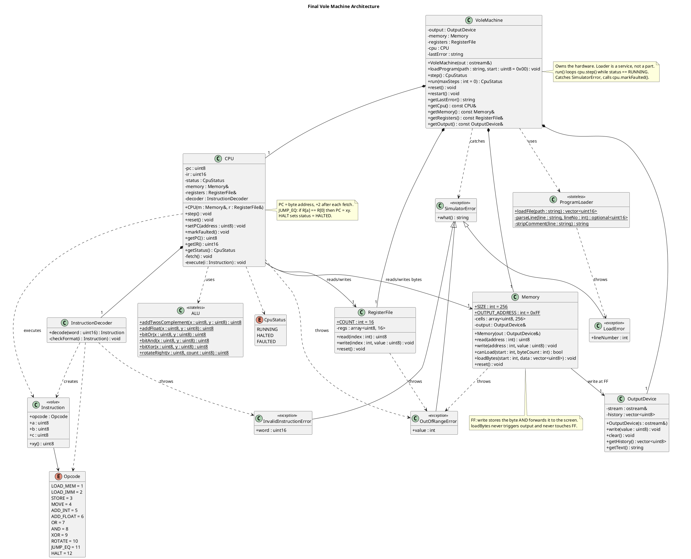

I can see the Initial Design and the Gemini revised answer in my context, but the DeepSeek and ChatGPT files didn't come through. I'll try reading them from disk.

All four uploads are readable. Before I write the review, I'll check whether I can syntax-test PlantUML here, since you asked for a valid diagram.

Status: I've read all four files and checked my final PlantUML diagram with PlantUML's check-only mode, so I'm writing up the full review now.

One caveat on the check: it reported no errors, but I couldn't render the diagram here, and the same check also accepted an arrow I wasn't sure about in Gemini's diagram. Paste the diagram into a PlantUML renderer to confirm it draws correctly.

# Vole Machine: Comparative Design Review and Final Architecture

## Phase 1: What I could and couldn't verify

**Read successfully:** `Initial_Design.md` and the three *revised* answers (DeepSeek, Gemini, ChatGPT). Your task brief was pasted in as text.

**Not in the uploads, so I did not use or guess at them:**
- The official assignment specification and the rubric.
- The two sample Vole programs and their explanations.
- The prompts you used.
- Rendered UML images.
- The three AIs' *initial* responses.

Two consequences follow:
1. I can't check the sample programs against the instruction set.
2. Everything I say about each AI's original design comes from what its revised answer says about it. That is secondary evidence, and I label it as such.

**Requirement classification**

| Category | Items |
|---|---|
| **Stated in your brief** (the closest thing to a spec I have) | 16 8-bit registers R0–RF; 256 bytes at 00–FF; 2-byte, 4-hex-digit instructions; PC counts bytes, +2 per instruction; BRXY compares R against R0; R0 is not hardwired to zero; FF is mapped to the screen; formats 40RS, AR0X, C000; 8-bit arithmetic; loader handles blank lines and `;` comments; invalid input needs defined behavior |
| **Implied by the instruction set** | Opcodes 1–C (load, load-immediate, store, move, integer add, float add, OR, AND, XOR, rotate, jump-if-equal, halt). The AI answers and your brief mention these, but I have not seen your spec's wording for them. |
| **Design choices (yours or the AIs')** | Observer or interface for output, ALU class, exceptions vs result structs, `Instruction` struct, loader ownership, reset contracts, executor class |
| **Optional** | `maxSteps` guard, `restart()`, pre-validating opcodes at load time, per-device output implementations |

## Phase 2: Comparison of the existing designs

### Per-design summary (from the files)

**Your initial design**
- *Strongest:*
  - Clean split into machine, CPU, memory, registers, decoder, loader and output.
  - Arrays instead of per-cell classes.
  - Explicit R0-is-not-zero note.
  - Awareness of 40RS/AR0X/C000.
  - The open questions in §7 were well chosen.
- *Weaknesses:*
  - `CPU.execute(instruction: short)` takes a raw word although a decoder exists.
  - `short` is signed in C++.
  - `ProgramLoader` holds state it doesn't need (`sourceFilePath`, `loadedInstructionCount`).
  - `initialize()`, `isInitialized` and `reset()` overlap.
  - `memorySize` and `registerCount` are listed as attributes but are really constants.
  - `isValidAddress(int)` is pointless next to a byte-typed address.
  - `Memory ..> OutputDevice` has no reference attribute behind it.
  - The CPU lists an `outputDevice` that the diagram never connects.
  - Halt and error signaling is not modeled.
  - The loader's `parseLine` returns an `Instruction`, which blurs loading and decoding.

**DeepSeek (revised)**
- *Strongest:*
  - Best on unstated conventions: PC in bytes, high-byte-first fetch, FF read policy, rotate, reset ordering.
  - Identifies the missing halt/continue/fault signalling channel.
  - Line-numbered `LoadResult`.
  - Honest "fold the executor into CPU?" trade-off.
  - Good observation that the existing handler list was incomplete.
- *Weaknesses:*
  - `ExecStatus` and `ExecResult` both exist for one value, and the diagram uses them inconsistently (CPU returns one, executor the other).
  - "VoleMachine owns OutputDevice by value" can't compile if `OutputDevice` is an interface.
  - `InstructionExecutor` needs a `CPU&` to change the PC, which weakens encapsulation.
  - The loader has two error channels (`LoadResult` and `MachineFault`).
  - `DecodedInstruction` has `s`, `t` *and* `xy`, which overlap.
  - `halted` lives in `VoleMachine`, not the CPU.
  - Claims "128 instructions fit" without noticing that an instruction at FE would need byte FF, the screen.
  - Two output implementations (`ConsoleOutputDevice`, `MemoryBufferOutput`) with no demonstrated need.
  - The reset-order reasoning ("clear output last") is weak unless reset itself writes through `write()`.

**Gemini (revised)**
- *Strongest:*
  - Stateless `ALU` (a useful place for float-add).
  - Observer (`IMemoryListener`) for memory-mapped output.
  - `halted` on the CPU.
  - Exception hierarchy.
  - Correctly resists per-cell/per-register classes.
- *Weaknesses:*
  - `Instruction` has `r, s, t, x, y`, so nibbles overlap and some fields are always meaningless.
  - `CPU::fetch(memory)` takes memory as a parameter while `CPU *-- RegisterFile`, so the two components are accessed inconsistently.
  - The observer receives *every* write, so each listener must know about address FF. That pushes the memory map into the display, which is the opposite of what it claims to fix.
  - The diagram never wires a `DisplayDevice` into `Memory` or `Machine`.
  - `Memory o--> "1..*"` should be 0..*.
  - `Loader::parseFile(path, memory)` writes memory directly, so it can bypass FF behavior.
  - "Handle alignment" on jumps is an unsupported assumption.
  - `Machine.running` duplicates `halted`.
  - Only the base `SimulatorException` is drawn; the three subclasses named in the text are missing.
  - The thread-safety argument is irrelevant here.

**ChatGPT (revised)**
- *Strongest:*
  - Removes the redundant CPU→Output path.
  - Generic `a/b/c` nibble fields, which fit every format.
  - Three-stage validation (text, decode, execution).
  - Byte-level fetch only.
  - Validate-whole-file-before-modifying-memory.
  - Explicit reset contracts.
  - The loader as a service, not a component.
  - Catches the FE/FF boundary conflict.
  - Warns about `PC+1` overflow in 8-bit types.
  - Most disciplined about not inventing features.
- *Weaknesses:*
  - Execution is a big private `execute` in CPU, including bit-twiddling and the still-undefined float add.
  - `ProgramLoader::loadInto(memory, …)` still gives the loader write access to memory.
  - No answer for how a fault reaches the caller, only "exceptions are probably enough".
  - `Instruction` is a class with public fields and no accessor for XY.
  - `Machine` and `CPU` both have `run()` in the diagram, despite the text saying CPU is the only executor.
  - FF behavior is deferred ("choose and document a policy") rather than decided.
  - No `getRegister`/`getMemory` observers for testing.
  - Declares that FF can't hold program bytes as a fact about the design, which is only an assumption.

### Comparison table

Legend: ✔ good, ◐ partial, ✘ weak. Sources are the revised answers only.

| Criterion | Initial | DeepSeek | Gemini | ChatGPT |
|---|---|---|---|---|
| Separation of responsibilities | ◐ decode/execute boundary unclear | ✔ but executor/CPU entangled | ◐ `Machine` vs `CPU` has the parts split oddly | ✔ clearest, though CPU does a lot |
| Cohesion / coupling | ◐ dangling output refs | ◐ executor needs `CPU&` | ◐ listener coupled to FF | ✔ lowest coupling |
| Encapsulation / access control | ◐ | ✔ non-owning pointers stated | ✔ std::array, getters | ✔ private validation, refs |
| Memory & registers | ✔ arrays | ✔ arrays | ✔ arrays | ✔ arrays |
| CPU state / PC / IR / execution | ◐ no halt/error model | ◐ halt channel fixed, `halted` in wrong class | ✔ `halted` in CPU | ✔ `halted` in CPU, getPC/IR |
| Decoding & validation | ◐ overlapping methods | ✔ decoder throws | ◐ overlapping fields | ✔ 3-stage model |
| Loading & errors | ◐ | ✔ line errors, ◐ two channels | ◐ writes memory directly | ✔ validate-then-write |
| FF output | ◐ undefined read/write | ✔ read policy decided | ◐ observer leaks FF knowledge | ◐ write via Memory, read undecided |
| Init / reset | ◐ overlapping | ✔ ordered (reasoning weak) | ✘ minimal | ✔ explicit contracts |
| Ownership / relationships | ◐ | ◐ by-value interface contradiction | ◐ inconsistent | ✔ consistent |
| Extensibility / testability | ◐ | ✔ | ✔ ALU, observer | ✔ |
| Unneeded abstraction | ✔ lean | ◐ 2 outputs, `ExecResult` | ◐ observer + ALU + exceptions | ✔ leanest |
| Correctness vs. your brief | ◐ | ✔ mostly | ◐ alignment claim | ✔ mostly |

**Overall:** ChatGPT is the strongest base because it is the most disciplined, DeepSeek has the best list of missing semantics, and Gemini contributes the ALU idea and the exception hierarchy. Class count and diagram size didn't influence this ranking.

## Phase 3: Design decisions

**1. Separate decoding from execution?**
- *Alternatives:* (a) CPU does both; (b) a separate decoder plus executor class (DeepSeek); (c) a separate decoder, with execution inside the CPU.
- *Choice:* (c). Decoding is pure (word in, validated fields out) and can be unit-tested alone. Execution *must* change the PC and halt status, which are CPU state. A separate executor (b) would need write access to the CPU, so it creates the coupling DeepSeek itself flagged.

**2. A dedicated `Instruction` structure?**
- *Alternatives:* raw 16-bit word everywhere, or a class hierarchy per opcode.
- *Choice:* a small value type `{opcode, a, b, c}` plus `xy()`. Generic nibbles fit all formats (ChatGPT's argument); named per-format fields overlap (Gemini's and DeepSeek's issue). A hierarchy is unjustified for 12 opcodes.

**3. Collections of bytes or a class per cell/register?**
- *Choice:* `std::array<uint8_t, N>` wrapped by `Memory` and `RegisterFile`. Cells share identical behavior, and all four proposals agree. A per-cell class would only pay off if cells needed metadata (breakpoints, access flags), which nothing here requires.

**4. How does a write to FF reach the screen?**
- *Alternatives:* (a) the CPU's store instruction checks for FF; (b) an observer interface on Memory (Gemini); (c) Memory holds an `OutputDevice&` and forwards writes at its own `OUTPUT_ADDRESS` constant.
- *Choice:* (c). (a) means every writer must remember the rule. (b) makes each listener re-check the address, so the display ends up knowing the memory map. In (c), only Memory knows the mapping.
- *FF write/read policy (my assumption):* a write to FF stores the byte *and* forwards it to the screen, and a read from FF returns the last stored byte (00 after reset). That removes DeepSeek's extra `lastScreenByte` attribute. Flagged in Phase 5E.
- *Loading:* `loadBytes` never triggers output.

**5. Should `ProgramLoader` be independent of `VoleMachine`?**
- *Choice:* Yes, and independent of `Memory` too. It is a stateless service: `loadFile(path)` returns a list of 16-bit words or throws `LoadError` with a line number. `VoleMachine` then checks capacity and stores the words. This fixes the "loader bypasses FF" worry in Gemini's and ChatGPT's designs, and a failed parse leaves the machine untouched.

**6. Who owns what?**
- `VoleMachine` owns `OutputDevice`, `Memory`, `RegisterFile` and `CPU` by composition.
- `Memory` holds a non-owning reference to the output device, and `CPU` to memory and registers. Members must be declared in that dependency order in C++.
- The loader is used, not owned.

**7. Invalid instructions, addresses and files**
- *Choice:* exceptions, each with one detector:
  - `LoadError`: bad file syntax or program too large (loader / machine).
  - `InvalidInstructionError`: bad opcode or reserved nibbles (decoder).
  - `OutOfRangeError`: bad address or register index (memory, register file, fetch).
- *Alternative:* result codes (DeepSeek's `LoadResult`). I rejected them because they give the loader two error channels and make the CPU check a code after every operation.
- *Caught where:* `VoleMachine::step/run` catches runtime faults, sets the CPU to `FAULTED` and stores the message. State stays inspectable.
- *Loader validation:* it checks syntax only. Words in a program file may be data, not instructions, so rejecting "invalid opcodes" at load time (ChatGPT's optional variation) could wrongly reject legal programs. Decoding validity is checked when a word is *fetched*.

**8. PC, jumps, halting**
- Fetch reads two bytes (high first) into `IR`, then does `PC += 2`.
- `JUMP_EQ` sets `PC = XY` only when `R[a] == R[0]`, so a non-taken jump falls through naturally. Note that `B0XY` compares R0 with itself, so it is always taken, which makes it an unconditional jump.
- `HALT` sets `status = HALTED`; further `step()` calls do nothing.
- Fetch rule (my assumption): a fetch is rejected if the instruction would use FF, i.e. `PC > FD`. There is no silent wrap-around and no rounding of jump targets to even addresses.

**9. What resets, and who does it**

| Operation | Effect | Responsible |
|---|---|---|
| `CPU::reset()` | PC=00, IR=0000, status=RUNNING | CPU |
| `RegisterFile::reset()` | all registers 00 | RegisterFile |
| `Memory::reset()` | all cells 00, **no screen output** | Memory |
| `OutputDevice::clear()` | clears history | OutputDevice |
| `VoleMachine::reset()` | all four above, clears `lastError` | VoleMachine |
| `VoleMachine::restart()` *(optional)* | CPU only: keeps program, registers and screen | VoleMachine |

Because `Memory::reset()` writes cells directly instead of going through `write()`, the reset *order* doesn't matter, unlike DeepSeek's ordering rule.

`loadProgram`'s sequence is: parse, check capacity, `reset()`, store the bytes, set PC. A failed load leaves the previous state intact.

**10. Are extra classes justified?**
- *Added:* `Instruction`, `Opcode` and `CpuStatus` enums, `ALU`, and three exception subclasses.
- *Rejected:* `Register`, `MemoryCell`, `InstructionExecutor`, `ControlUnit`, `IMemoryListener`, `ExecResult`/`LoadResult`, two output implementations.
- *`ALU` is the most debatable addition.* Its case: float add needs its own tests, and the CPU's switch stays free of bit-twiddling. Its weakness: OR, AND and XOR are one operator each. If your instructor sees it as over-engineering, fold it into `CPU` with no other change.

## Phase 4: Final design

### Overview
`VoleMachine` is a thin facade that owns the hardware components and the run loop. The `CPU` runs fetch, decode and execute. `Memory` is the only class that knows address FF is special. `ProgramLoader` turns a text file into 16-bit words and knows nothing else.

### Classes

| Class | Responsibility | Key attributes (private unless noted) | Key methods |
|---|---|---|---|
| `VoleMachine` | Owns components; load, step, run, reset; catches runtime faults | `output`, `memory`, `registers`, `cpu`, `lastError` | `loadProgram(path, start)`, `step()`, `run(maxSteps)`, `reset()`, `restart()`, read-only getters (public) |
| `CPU` | Fetch-decode-execute; owns PC, IR, status | `pc`, `ir`, `status`, `Memory&`, `RegisterFile&`, `decoder` | public `step()`, `reset()`, `setPC()`, `markFaulted()`, getters; private `fetch()`, `execute()` |
| `InstructionDecoder` | Word → validated `Instruction` | none | `decode(word)`; private `checkFormat()` |
| `Instruction` | Decoded value | public `opcode`, `a`, `b`, `c` | `xy()` |
| `ALU` | Pure 8-bit arithmetic and logic | none | static add (two's complement), add (float), or, and, xor, rotate right |
| `Memory` | 256 bytes; range checks; FF forwarding | `cells`, `OutputDevice&`; constants `SIZE`, `OUTPUT_ADDRESS` | `read`, `write`, `canLoad`, `loadBytes`, `reset` |
| `RegisterFile` | 16 registers; index checks | `regs`; constant `COUNT` | `read`, `write`, `reset` |
| `ProgramLoader` | File → words (syntax only) | none | static `loadFile`; private `parseLine`, `stripComment` |
| `OutputDevice` | Screen: echo and record bytes | `stream&`, `history` | `write`, `clear`, `getHistory`, `getText` |
| `SimulatorError` + `LoadError`, `InvalidInstructionError`, `OutOfRangeError` | Error types | line / word / value | `what()` |

### Instruction field mapping

| Format | Meaning | a | b | c | Decoder rule |
|---|---|---|---|---|---|
| `1RXY`, `2RXY`, `3RXY`, `BRXY` | load, load-imm, store, jump-if-equal | R | X | Y | none |
| `40RS` | move | 0 | R | S | `a == 0` |
| `5RST` … `9RST` | add, float add, or, and, xor | R | S | T | none |
| `AR0X` | rotate right | R | 0 | X | `b == 0` |
| `C000` | halt | 0 | 0 | 0 | all zero |

Other opcode nibbles (0, D–F) raise `InvalidInstructionError`.

### Execution workflow
1. `loadProgram`: `ProgramLoader::loadFile` returns the words (strips `;` comments and blank lines, requires four hex digits, throws `LoadError` with line number).
2. The machine converts the words to bytes (high byte first) and checks `memory.canLoad`. If the program doesn't fit, it throws `LoadError` and the machine is untouched.
3. `reset()`, then `memory.loadBytes`, then `cpu.setPC(start)`.
4. `run()` calls `cpu.step()` while `status == RUNNING` (and under `maxSteps`, if given).
5. Each `step()` does `fetch` (read two bytes, `PC += 2`), `decode`, `execute`.
6. A store to FF goes through `Memory::write` and appears on the screen.
7. `C000` sets `HALTED`, so the loop ends. If an exception occurs instead, `VoleMachine` records the message with PC and IR, calls `cpu.markFaulted()` and returns `FAULTED`.

### Error-handling responsibilities

| Problem | Detected by | Result |
|---|---|---|
| Unreadable file, bad line, not 4 hex digits | `ProgramLoader` | `LoadError` (with line number) |
| Program too large or touches FF | `VoleMachine` via `Memory::canLoad` | `LoadError` |
| Invalid opcode or reserved nibble ≠ 0 | `InstructionDecoder` | `InvalidInstructionError` → `FAULTED` |
| Address outside 0–255, register index > 15 | `Memory`, `RegisterFile` | `OutOfRangeError` → `FAULTED` |
| PC beyond FD | `CPU::fetch` | `OutOfRangeError` → `FAULTED` |

### PlantUML diagram
Passed PlantUML check-only mode with no errors reported (not rendered here).

### How the final design improves on each proposal
- **vs. your initial design:** adds a decoded `Instruction`, makes halt/fault states explicit, removes the redundant `initialize` and `isInitialized`, turns constants into constants, makes the loader stateless, and fixes the dangling output references.
- **vs. DeepSeek:** keeps its conventions but drops `InstructionExecutor` and the duplicate `ExecResult`/`ExecStatus`. It also has one error channel and no by-value interface.
- **vs. Gemini:** keeps `ALU` and the exceptions, but replaces the observer with a direct Memory→OutputDevice link and uses overlap-free instruction fields. Halt lives in the CPU, and the loader no longer writes memory.
- **vs. ChatGPT:** keeps its structure and rules but decides the FF policy, adds the `ALU` and the fault channel to the caller, and removes the loader's memory access.

## Phase 5: Report-ready evidence

### A. Comparison summary (for the report)
All four designs agree on the core split (machine, CPU, memory, register file, decoder, loader, output) and on using arrays rather than per-cell classes. They differ in where decisions are hidden. The initial design left halt and error signaling, FF behavior and loader boundaries open. DeepSeek's revision best identified missing conventions (PC units, byte order, FF reads) but added an executor that must reach into the CPU. Gemini's revision contributed an ALU and exception types, but its observer pattern leaks the FF mapping to the listeners and its instruction fields overlap. ChatGPT's revision was the most disciplined, removing the CPU's output link and defining reset and loading rules, but it left FF reads undecided and gave no fault-reporting path. The final design starts from ChatGPT's structure, adopts DeepSeek's explicit conventions and Gemini's ALU and exceptions, and rejects the extra layers that did not solve a demonstrated problem.

### B. Decision log

| # | Decision | Justification |
|---|---|---|
| 1 | Decoder separate; execute inside CPU | Decode is pure; execute must mutate PC and status |
| 2 | `Instruction {opcode, a, b, c}` | Fits all formats, no overlapping fields |
| 3 | Arrays, no cell/register classes | Identical behavior, no per-item metadata needed |
| 4 | Memory forwards FF to `OutputDevice` | Only Memory knows the mapping |
| 5 | FF write stores and displays; read returns stored byte | One uniform memory model *(assumption)* |
| 6 | Loader stateless and memory-free | Testable, cannot bypass the FF rule |
| 7 | Syntax-only loading; opcode validity checked at fetch | Files may contain data words |
| 8 | Exceptions with three subclasses | One detector per error, caller reacts differently |
| 9 | `VoleMachine` catches runtime faults, CPU status `FAULTED` | State stays inspectable, no crash |
| 10 | `PC += 2` at fetch, jump overwrites it | Non-taken jump needs no extra code |
| 11 | Fetch only if `PC ≤ FD` | FF is the screen *(assumption)* |
| 12 | Reset via direct cell writes | Reset never prints; order doesn't matter |
| 13 | `ALU` as a stateless class | Isolates float add; foldable into CPU |
| 14 | No `maxSteps` by default | Optional guard against infinite loops |

### C. Change summary versus your initial design

| Status | Items |
|---|---|
| **Retained** | `VoleMachine`, `CPU`, `Memory`, `RegisterFile`, `InstructionDecoder`, `ProgramLoader`, `OutputDevice`, arrays, R0 rule, byte-PC |
| **Modified** | Loader made stateless and memory-free; CPU `execute` takes a decoded `Instruction`; `short` → `uint16`; `Memory::read/write` take a wide `int` so out-of-range is detectable; `OutputDevice` simplified (dropped `lastOutput`) |
| **Added** | `Instruction`, `Opcode`, `CpuStatus`, `ALU`, exception hierarchy, FF read/write policy, fetch boundary rule, reset contracts, `canLoad`, fault capture in `VoleMachine`, read-only observers |
| **Removed** | `initialize()`, `isInitialized`, `memorySize`/`registerCount` as attributes, `isValidAddress`/`isValidRegister` public checks, loader attributes, `getMachineState()`, the CPU's `outputDevice` and `CPU::run()` |

### D. Points for your 10-minute video
1. **Which of the four designs is best?** Explain why "most elaborate" lost (e.g., DeepSeek's executor needing `CPU&`).
2. **The FF decision.** Direct link vs observer: where should the "what is special about FF" knowledge live?
3. **Halt and fault signaling.** Why I gave the CPU a status enum rather than a result struct per step.
4. **Load-time vs fetch-time validation.** The "files can contain data" argument.
5. **The `ALU` trade-off.** Say openly that it's the most debatable class and what folding it into CPU would cost.
6. **The `B0XY` quirk.** Compare against R0 means R0 vs itself, so an unconditional jump.
7. **Atomic load.** Why `loadProgram` parses first and only then resets.
8. **Ownership.** Why the loader is a service and not a component, and the construction-order caveat in C++.
9. **What you rejected.** `Register`/`MemoryCell`, executor, observer, `ExecResult`.
10. **One honest limit.** Which assumptions are yours (FF policy, fetch boundary, strict reserved nibbles).

### E. Ambiguities to confirm with your instructor
- Is the screen at **FF** exactly as your brief says? (Some published Vole/Brookshear descriptions use 00. Your design keeps it as one constant, so changing it is trivial.)
- How is screen output displayed: raw ASCII character, hex, or decimal?
- What does a read from FF return, and may a program file occupy FF (and the instruction at FE)?
- What is the exact encoding for `6RST` float add?
- Exact program-file format: one instruction per line? Are lowercase hex, a `0x` prefix, or spaces inside a word allowed? Can a file specify addresses, or are words always sequential from 00?
- Should reserved nibbles (`40RS`'s second digit, `AR0X`'s third, `C000`) be strictly validated or ignored?
- What are the initial register and memory values?
- What should happen when execution runs off the end of the program (zero words → invalid opcode in this design)?
- Are odd jump targets legal?

Two final reminders: the sample programs weren't provided, so I haven't checked them against the instruction set, and I only saw the three AIs' revised answers, not their originals. If you upload the spec and samples, I can redo the correctness check and tighten any assumptions above. I can also save this as a Markdown file if you'd like one for the report.