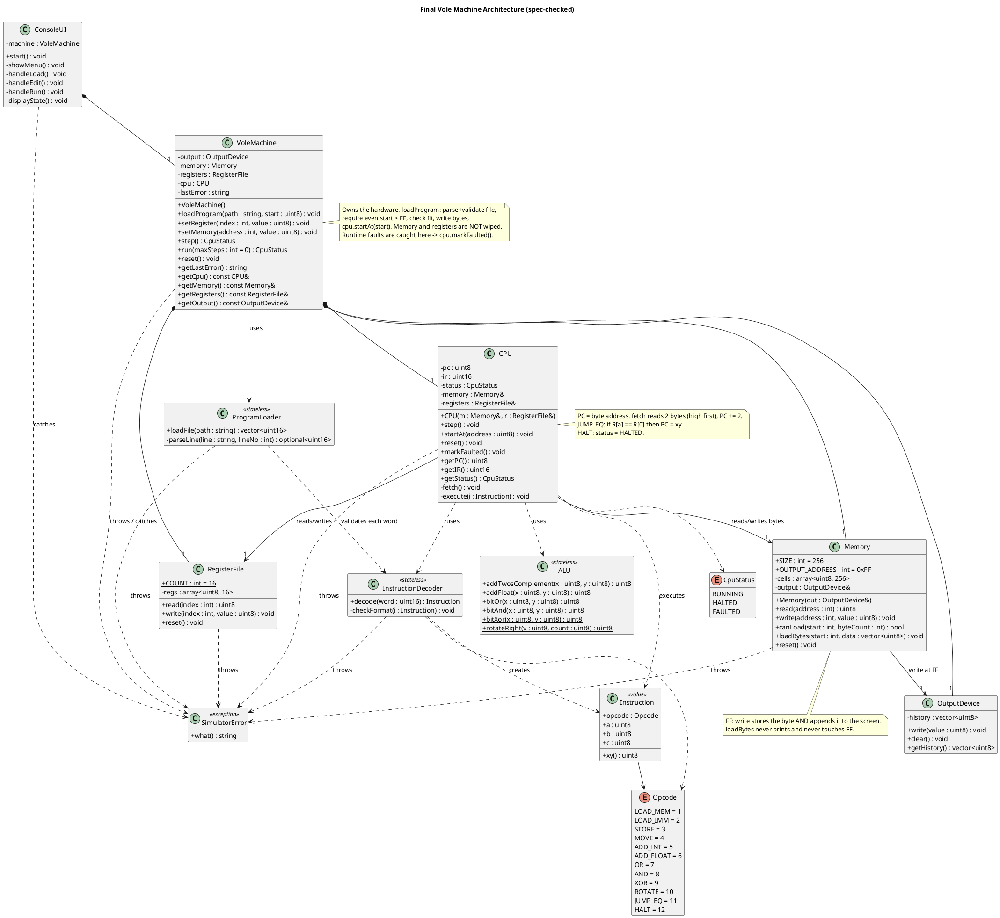

The assignment spec changes several of my earlier conclusions, so I'll first re-test the diagram tooling, since the earlier check-only run never actually showed it catches errors.

The spec turned up several real problems in my earlier design, including a missing UI class and a load-time validation rule I had gotten backwards.

The PDF also has a stray, oddly spaced paragraph under Task 3 asking for a `/*/*/*` separator, a "Date: 6 Oct 1973" header, and silly comments in the code. It isn't part of a design review and I haven't acted on it. Check whether it's really in your handout, since it looks out of place.

PlantUML check on the corrected diagram below: the check-only run reports no errors, and it rendered to SVG with the pure-Java layout. I also confirmed that this checker does flag a deliberately broken file, so a clean result means something. The earlier "no errors" result on my first diagram was therefore valid too.

## Spec-conflict you must raise with the instructor

The spec's own sample program ends with `3200 ; Store register 2 into memory[00] (screen output)`, but the instruction table says the screen is at **FF** (marked "Added"). Under the table, `3200` writes to ordinary memory cell 00 and prints nothing, so the sample would not display "12". Most likely the sample is stale from an older version where the screen was at 00, and should read `32FF`. The sample also says "(12)" while the result is stored as `0C`, so the screen format (decimal, hex or character) is unspecified too. Ask about both.

## Verification results

**1. Instruction formats** (checked against the spec's examples)

| Format | Example | Fields | Verdict |
|---|---|---|---|
| `1RXY` | `14A3` | a=R, xy=A3 | ✔ |
| `2RXY` | `20A3` | a=R, xy=A3 | ✔ |
| `3RXY` | `35B1` | a=R, xy=B1 | ✔ |
| `3RFF` | store to FF | xy=FF, goes to screen | ✔ covered by `3RXY` + Memory's FF rule |
| `40RS` | `40A4` | a=0, b=R (source), c=S (destination) | ✔ copy `regs[c] = regs[b]` |
| `5RST`–`9RST` | `5726` | a=R (result), b=S, c=T | ✔ |
| `AR0X` | `A403` | a=R, b=0, c=X (rotate count) | ✔ |
| `BRXY` | `B43C` | a=R, xy=3C; jump if `R[a] == R[0]` | ✔ |
| `C000` | | all nibbles zero | ✔ |

Opcode values 10, 11 and 12 for A, B and C are right. The spec lists only opcodes 1–C, so 0 and D–F are invalid, which is spec-backed. Rejecting non-zero "reserved" nibbles (the 0 in `40RS`, `AR0X` and `C000`) is my **assumption**. The spec shows those as literal zeros but never says what happens otherwise.

**2. PC, fetch, jumps, halt, 8-bit arithmetic**
- Fetch reads two bytes high byte first, then `PC += 2`. This matches the spec's wording that a jump "copies XY into the program counter during the execute phase."
- Integer add wraps modulo 256, which is the natural reading of 8-bit registers. The spec gives no overflow rule.
- `B0XY` always jumps, because R0 is compared with itself. The spec example is consistent with this.
- The PC value shown after a halt (address after `C000`) is my **assumption**; the spec only says "execution stops."
- Float add (`6RST`): the assignment says "floating-point notation" but doesn't define the format. Brookshear describes it elsewhere in the book (outside pages 73–93, so verify). I believe it is 1 sign bit, 3 exponent bits (excess-four) and 4 mantissa bits, but that is **unconfirmed**.

**3. FE/FF boundary, specified vs. assumed**
- **Specified:** a program loads at an **even** address **< FF**, and writing to FF is writing to the screen.
- **Not specified:** whether a program may occupy FF, what a read from FF returns, and whether a program started at FE is legal.
- **Assumption (kept):** no program byte may live at FF, and a fetch needs `PC ≤ FD`. The consequence is that FE is nominally an allowed start address but can never hold a whole instruction, so effectively the last usable start is FC. Both limits live in one place (`Memory::canLoad` and the fetch check), so they are easy to change.
- **Assumption (kept):** a store to FF both records the byte on the screen and stores it in cell FF.

**4. Justification of `Instruction`, `ALU`, exceptions, ownership**
- `Instruction`: justified, because one decoded form serves both the decoder and the CPU.
- `ALU`: not required by the spec. Keep it only because the float add needs isolated testing, and label it a design choice. You can fold it into `CPU` with no other change.
- Exception subclasses: not justified. No caller branches on error type; every catcher just prints a message. One `SimulatorError` with a message is enough (see correction 7).
- Ownership: sound. `VoleMachine` owns the hardware, `Memory` and `CPU` hold non-owning references, and the loader and decoder are stateless.

## Necessary corrections

| # | Issue | Why it matters | Minimal fix |
|---|---|---|---|
| 1 | **No class for the menu or display.** The spec requires a menu, a memory matrix, IR/PC/register display, run all vs. step, press Enter, and "exit or load another." | Without it the design doesn't implement Task 1's listed behavior, and machine classes would end up printing. | Add `ConsoleUI` owning a `VoleMachine`. This is the only added class, and the spec demands it. |
| 2 | **Load-time validation was wrong.** I said the loader checks syntax only. The spec says invalid instructions are rejected **and the simulator should reject programs with invalid instructions**. | A program with an invalid opcode must not load. | `ProgramLoader` runs every word through `InstructionDecoder` before anything is written. Keep the fetch-time check too, since the user can edit memory from the menu. |
| 3 | **Loading wiped everything.** I had `loadProgram` call `reset()`. | The spec allows several programs at different even addresses and lets the user overwrite memory and registers, so a load shouldn't erase them. | `loadProgram` leaves memory and registers alone. It writes the bytes and calls `cpu.startAt(start)`, which sets PC, clears IR and sets status to `RUNNING`. Clearing the screen on load is an **assumption**. `reset()` stays as an optional menu item. |
| 4 | **Even start address wasn't enforced.** | Explicit spec requirement (even, < FF). | `loadProgram` throws `SimulatorError` if `start` is odd or `≥ FF`, or if `Memory::canLoad` fails. |
| 5 | **Missing overwrite operations.** I only had read-only getters. | The spec requires overwriting registers and memory. | Add `VoleMachine::setRegister(index, value)` and `setMemory(address, value)`. A poke to FF goes through `Memory::write`, so it shows on the screen. That is an **assumption**. |
| 6 | **Live echo in `OutputDevice`.** It wrote to a stream during execution. | The spec says the screen is shown after the run finishes, or after each step. | Remove the stream and `getText()` from `OutputDevice`. It only records bytes, and `ConsoleUI` decides how to show them. The constructor loses its stream parameter. |
| 7 | **Four exception classes.** | No caller distinguishes them. | Collapse to one `SimulatorError` with a message that includes any line number or address. |
| 8 | **Loader parsing was stricter than the spec.** I required nothing but a comment after the four digits. | The spec says only the first four hex digits matter and "the rest of the line is ignored." | `parseLine`: skip blank lines and lines starting with `;`; otherwise the first four characters must be hex digits, and the rest is ignored. Remove `stripComment`. Leading whitespace and lowercase hex are allowed as **assumptions**. A malformed line is a `SimulatorError`. |
| 9 | **Decoder ownership.** Both `CPU` and `ProgramLoader` now need it. | One owner would force the other to reach through it. | Make `InstructionDecoder` static and stateless. `CPU` and `ProgramLoader` depend on it with `..>`. |
| 10 | **Dropped optional extras.** `restart()` and the CPU's `setPC()`. | `restart()` isn't needed once load doesn't wipe state, and `setPC` hid a status side effect. | Remove `restart()` and replace `setPC` with `startAt`. |

## Corrected final diagram

## Remaining items to confirm with your instructor

1. Is the screen at FF, as the table says, or at 00, as the sample program shows? Should the sample read `32FF`?
2. How should screen bytes be displayed: decimal, hex or ASCII?
3. May a program occupy FF, and is a start address of FE legal?
4. What is the exact 8-bit float format for `6RST`?
5. Should non-zero "reserved" nibbles in `40RS`, `AR0X` and `C000` be rejected?
6. May jump targets be odd addresses?
7. Should loading clear the screen, memory or registers?

The classes and their responsibilities are otherwise unchanged from my earlier answer, apart from the corrections above.