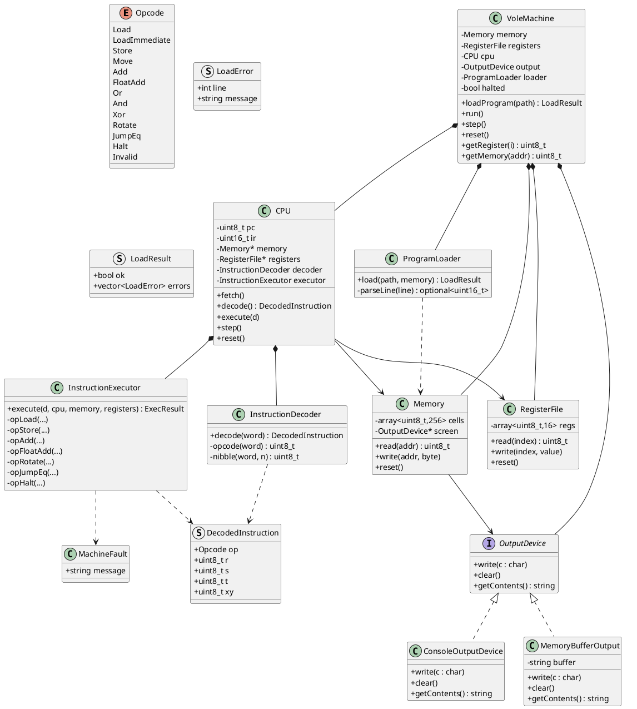

# Vole Machine Simulator — OOP Architecture Proposal

## 1. Classes and Responsibilities

I propose a layered design: a **machine facade** that owns the components, **memory and register file** as data stores, an **instruction decoder** that translates hex words into typed operations, an **executor/dispatcher** that performs them, and a small **output device** abstraction for the screen-mapped byte. Program loading is separated into a `ProgramLoader`.

### 1.1 `VoleMachine` (Facade / Simulator controller)
Owns all components and orchestrates the fetch-decode-execute loop.
- **Responsibility:** lifecycle control (load, run, step, reset), wiring components, exposing a clean API to the outside (CLI/GUI/tests).
- **Attributes:** `Memory memory`, `RegisterFile registers`, `CPU cpu` (which owns PC/IR and a reference to decoder+executor), `OutputDevice output`, `ProgramLoader loader`, `bool halted`.
- **Methods:** `loadProgram(path)`, `run()`, `step()`, `reset()`, `getRegister(i)`, `getMemory(addr)`.

### 1.2 `Memory`
Byte-addressable store of 256 bytes with special handling of address `FF`.
- **Attributes:** `std::array<uint8_t,256> cells` (or a vector), `OutputDevice* screen` (address FF routes here).
- **Methods:** `read(addr)`, `write(addr, byte)`, `reset()`.
- **Note:** Writes to `FF` delegate to the output device rather than storing silently; reads of `FF` may return the last written byte or 0 (document the choice).

### 1.3 `RegisterFile`
Holds 16 general-purpose 8-bit registers.
- **Attributes:** `std::array<uint8_t,16> regs`.
- **Methods:** `read(index)`, `write(index, value)`, `reset()`.
- **Design point:** A single `RegisterFile` is preferred over 16 `Register` objects — see §6.

### 1.4 `CPU`
Holds the program counter and instruction register and drives one cycle.
- **Attributes:** `uint8_t pc` (or `uint16_t` if you keep byte addresses), `uint16_t ir` (the 4-hex-digit instruction), references to `Memory`, `RegisterFile`, `Decoder`, `Executor`.
- **Methods:** `fetch()`, `decode()`, `execute(decoded)`, `step()` (fetch→decode→execute), `reset()`.

### 1.5 `InstructionDecoder`
Pure translation: hex word → structured instruction.
- **Responsibility:** parse opcode nibble, extract register/address operands, validate opcode.
- **Methods:** `DecodedInstruction decode(uint16_t word)`; internal helpers `opcode(word)`, `nibble(word, n)`.
- **Produces:** `DecodedInstruction { Opcode op; uint8_t r, s, t; uint8_t xy; }` (a small value struct, not a class hierarchy — see §6).

### 1.6 `InstructionExecutor`
Executes a `DecodedInstruction` against memory and registers.
- **Responsibility:** implement semantics of each opcode (1RXY, 2RXY, …, C000), including two's-complement arithmetic, float addition, rotates, conditional jump, halt signal.
- **Methods:** `execute(const DecodedInstruction&, CPU&, Memory&, RegisterFile&)`; private per-opcode handlers `opLoad`, `opStore`, `opAdd`, `opFloatAdd`, `opOr`, `opAnd`, `opXor`, `opRotate`, `opJumpIfEqual`, `opHalt`.
- **Note:** Executor returns a result flag (e.g., `halt`), so the CPU doesn't need to know instruction details.

### 1.7 `ProgramLoader`
Reads a text file, strips blank lines and `;` comments, parses four-hex-digit instructions, writes them into memory.
- **Methods:** `load(path, Memory&)`; `parseLine(line) -> optional<uint16_t>`.
- **Error handling:** throws or returns a `LoadResult` with line numbers and messages for malformed lines.

### 1.8 `OutputDevice`
Abstracts the screen (address FF).
- **Methods:** `write(char)`, `clear()`, `getContents()`.
- **Implementations:** `ConsoleOutputDevice` (writes to stdout), `MemoryBufferOutput` (for tests). Allows simulator to run headless.

### 1.9 Value types (not full classes)
- `enum class Opcode { Load, LoadImmediate, Store, Move, Add, FloatAdd, Or, And, Xor, Rotate, JumpEq, Halt, Invalid };`
- `struct DecodedInstruction { Opcode op; uint8_t r, s, t, xy; };`
- `struct LoadResult { bool ok; std::vector<LoadError> errors; };`

Keeping these as structs/enums avoids needless class ceremony.

---

## 2. Important Attributes and Methods (summary table)

| Class | Key attributes | Key methods |
|---|---|---|
| `VoleMachine` | memory, registers, cpu, output, loader, halted | loadProgram, run, step, reset |
| `Memory` | `array<uint8_t,256>`, `OutputDevice*` | read, write, reset |
| `RegisterFile` | `array<uint8_t,16>` | read, write, reset |
| `CPU` | pc, ir, refs to components | fetch, decode, execute, step, reset |
| `InstructionDecoder` | (stateless) | decode(word) |
| `InstructionExecutor` | (stateless or holds refs) | execute(decoded, …), per-opcode handlers |
| `ProgramLoader` | (stateless) | load(path, memory), parseLine |
| `OutputDevice` | buffer/stream | write, clear, getContents |

---

## 3. Relationships

- **Composition:** `VoleMachine` *owns* `Memory`, `RegisterFile`, `CPU`, `OutputDevice`, `ProgramLoader`. They do not outlive the machine.
- **Composition:** `CPU` owns `pc`/`ir` and *owns* (or holds by value) a `Decoder` and `Executor`. Alternatively the machine owns them and the CPU holds references — both valid; owning them inside CPU keeps the cycle self-contained.
- **Association:** `Memory` has an association to `OutputDevice` (address FF routes there). `CPU` has associations to `Memory` and `RegisterFile`.
- **Dependency:** `ProgramLoader` depends on `Memory` (writes into it). `InstructionDecoder` depends only on the value type `DecodedInstruction`. `InstructionExecutor` depends on `DecodedInstruction`, `Memory`, `RegisterFile`, `CPU` (for PC changes/halt).
- **Interface realization:** `ConsoleOutputDevice` and `MemoryBufferOutput` implement `OutputDevice`.

No inheritance among core components — this is deliberate (§9).

---

## 4. How the Pieces Work Together

**Loading.** `VoleMachine::loadProgram(path)` calls `ProgramLoader::load(path, memory)`. The loader reads line by line, trims whitespace, skips blank lines and lines whose first non-space char is `;` (or strips trailing `;` comments), validates each token is exactly four hex digits, and writes the two bytes (high byte, low byte) at successive addresses starting at 00. Malformed lines are collected into a `LoadResult`; loading either aborts atomically or reports line numbers.

**Fetch.** `CPU::step()` reads the byte at `pc` and the next byte, combining them into `ir = (hi<<8)|lo`, then increments `pc` by 2.

**Decode.** `CPU` passes `ir` to `InstructionDecoder::decode`, which extracts the opcode nibble and operand fields into a `DecodedInstruction`. Invalid opcodes are marked `Opcode::Invalid` and rejected (halt with error or throw a `MachineFault`).

**Execute.** `CPU` calls `InstructionExecutor::execute(decoded, *this, memory, registers)`. The executor switches on opcode:
- Load/store: `registers.write(r, memory.read(xy))` / `memory.write(xy, registers.read(r))`.
- Load immediate: `registers.write(r, xy)`.
- Move/Add/Or/And/Xor: register-to-register operations; Add uses two's-complement (`static_cast<uint8_t>(a+b)`).
- Float add: reinterpret operands as small floats (document a fixed convention, e.g., 8-bit "mini-float" — a known ambiguity in this assignment).
- Rotate: rotate 8-bit value right by `x` bits.
- Jump: if `registers.read(r)==registers.read(0)`, set `pc = xy`.
- Halt: executor returns `Halt`; CPU sets `halted`.

**Output.** Any `memory.write(0xFF, byte)` is intercepted and forwarded to `output.write(byte)`; the device decides how to display (console, buffer). Reads of `FF` return the last written value or 0 per documented policy.

**Reset.** `VoleMachine::reset()` calls `registers.reset()`, `memory.reset()`, `cpu.reset()` (pc=0, ir=0), `output.clear()`, `halted=false`. Memory reset must not clobber the output association.

---

## 5. Encapsulation, Validation, Error Handling

- **Encapsulation:** data (`cells`, `regs`, `pc`, `ir`) is private; access only through accessors. Address/register indices validated (`0..255`, `0..15`) — throw `std::out_of_range` or a `MachineFault`.
- **Validation:** decoder rejects non-hex input (loader) and unknown opcodes (runtime). Loader validates 4-hex-digit format, operand ranges implicitly via nibble extraction.
- **Error handling strategy:** distinguish **load-time errors** (recoverable, reported with line numbers, `LoadResult`) from **runtime faults** (invalid opcode, out-of-range access — throw `MachineFault` that `VoleMachine::run` catches, reports, and halts). Avoid silent failures.
- **Invariants:** PC stays within `[0,255]`; wrap or fault on overflow (document). Memory address FF is write-only for screen semantics (or last-value read).

---

## 6. Are Separate Classes Justified?

| Candidate class | Verdict | Reasoning |
|---|---|---|
| `Register` object per register | **No** | 16 tiny 8-bit values with no behavior; a `RegisterFile` array is simpler, cache-friendly, and easier to reset/iterate. A `Register` class adds ceremony with no encapsulation benefit. |
| `MemoryCell` object | **No** | Same reasoning; a byte array with bounds-checked `read`/`write` is clearer. Special-case FF in `Memory`, not in a cell. |
| `InstructionDecoder` | **Yes** | Isolates parsing logic, testable in isolation, keeps CPU small; supports adding opcodes in one place. |
| `OutputDevice` | **Yes** | Enables headless testing and multiple displays; the FF mapping is a real seam. |
| `DecodedInstruction` as class hierarchy | **No** (struct) | A tagged struct + enum is sufficient; per-instruction subclasses would explode class count for trivial operand extraction. |
| `InstructionExecutor` | **Yes** (or fold into CPU) | Separating decode from execute is clean; folding into CPU is acceptable for a small machine — explain the trade-off. |

---

## 7. Design Problems, Complexity, Edge Cases

- **Ambiguity of 6RST (floating-point add):** 8-bit registers can't hold IEEE floats. Must document a convention (e.g., interpret as tiny fixed-point or a documented mini-float); otherwise the design is under-specified.
- **Rotate semantics:** right rotate by X bits — X is a nibble (0–15), so rotate by `X % 8`; define behavior for X=0.
- **Jump target:** `BRXY` sets PC to XY — but instructions are 2 bytes, so PC addressing convention (byte vs. instruction index) must be fixed and documented; mismatch is a classic bug.
- **Memory-mapped FF:** writes to FF trigger output; reads are ambiguous — decide and document. Also, storing a register to FF must not corrupt normal memory.
- **PC overflow / running past program:** define halt-on-0x00 or fault; wrap is dangerous.
- **Over-engineering risk:** full Instruction class hierarchy, per-cell objects, observer patterns for every register — all unnecessary for this scale.
- **Loader atomicity:** partial load on error leaves machine in inconsistent state; prefer validate-then-commit.
- **Self-modifying code:** storing to addresses that hold future instructions is legal; ensure memory and fetch share the same store.

---

## 8. PlantUML Class Diagram

---

## 9. Reasoning Behind Major Choices

1. **Facade `VoleMachine`** gives callers one entry point and keeps ownership/lifecycle in one place; tests can drive `step()` deterministically.
2. **Data-holding `Memory`/`RegisterFile`** rather than per-cell/per-register objects: the machine is small and value-oriented; arrays with bounds-checked access provide encapsulation without ceremony.
3. **Decoder separate from Executor:** parsing and semantics change for different reasons; separating them makes both testable and keeps `CPU` a thin cycle driver. Folding executor into CPU is a defensible alternative for a smaller footprint — the trade-off is testability vs. file/class count.
4. **`DecodedInstruction` as a tagged struct**, not a class hierarchy: the operand shape is uniform (r,s,t,xy), so polymorphism buys nothing; an enum + struct is simpler and faster.
5. **`OutputDevice` interface** isolates the FF screen mapping, enabling headless tests and multiple front-ends; `Memory` holds a pointer so it doesn't own the device.
6. **`ProgramLoader` separate** because file parsing/validation is orthogonal to execution and needs its own error reporting (line numbers).
7. **Explicit error taxonomy** (`LoadResult` vs `MachineFault`) distinguishes recoverable load issues from runtime faults, matching the assignment's "blank lines and comments" tolerance.
8. **No gratuitous patterns:** no observers on registers, no visitor over instructions, no per-cell objects — these would add complexity without addressing the actual seams (decode, output, loading).
9. **Documented conventions** for the under-specified parts (float add, rotate-by-X, FF read, PC addressing) are part of the design, since the spec leaves them open; making them explicit prevents divergent implementations.