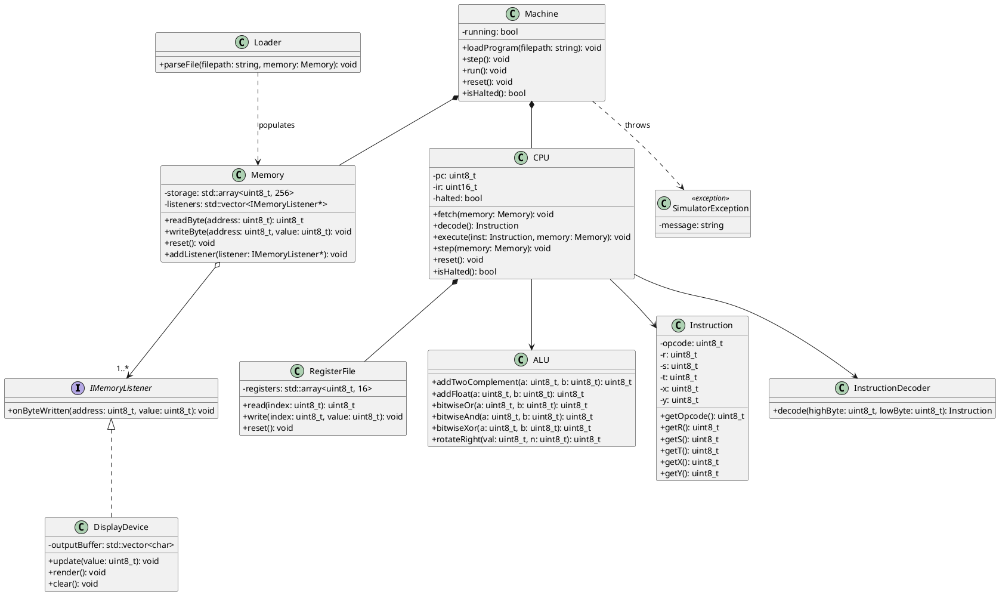

An architectural review and critical evaluation of the original Vole Machine simulator design identifies key areas for refinement, spec compliance, and structural decoupling.

---

## 1. Missing Responsibilities, Classes, Attributes, Methods, or Relationships

* **Halt Status & Execution Flag:** The original design lacked an explicit `halted` state in the `CPU` or `Machine`. When instruction `C000` (Halt) executes, the simulation loop needs a reliable way to terminate without relying solely on an external check. A `halted` boolean attribute in `CPU` (exposed via `isHalted()`) is necessary.
* **Decoupled Memory Observer Interface (`IMemoryListener`):** In the original design, `Memory` held a direct pointer to `DisplayDevice`. This tightly couples memory logic to a specific UI/display component. Introducing an abstract observer interface (`IMemoryListener`) allows `Memory` to notify any registered listener (such as a `DisplayDevice` or a debugging logger) when address `FF` is written to, without depending on concrete UI classes.
* **Structured Exception Hierarchy:** Specific custom exception classes (`MemoryOutOfBoundsException`, `InvalidOpcodeException`, `FileLoadException`) were mentioned conceptually but not modeled in the class structure. Explicitly defining them improves error management.

---

## 2. Unnecessary Classes or Complexity

* **Retaining `InstructionDecoder`:** While some might argue decoding can live inside `CPU`, keeping `InstructionDecoder` as a distinct stateless helper class is beneficial. It keeps the `CPU` focused on execution control rather than bit-shifting and nibble extraction, adhering to the Single Responsibility Principle.
* **Avoiding Over-Engineering:** The original design correctly avoided creating 256 individual `MemoryCell` objects and 16 individual `Register` objects. Sticking to `std::array` wrappers (`RegisterFile` and `Memory`) remains the correct choice for performance, simplicity, and hardware accuracy.

---

## 3. Compliance with Vole Machine Specifications

| Specification Item | Original Compliance | Revised Verification & Adjustments |
| --- | --- | --- |
| **16 Registers ($R_0$–$R_F$)** | Yes (`RegisterFile`) | Verified. Handled safely via 4-bit nibble indexing ($0$–$F$). |
| **256-Byte Memory ($00$–$FF$)** | Yes (`Memory`) | Verified. Byte-addressable array storage. |
| **Two-Byte Instructions** | Yes (`CPU::fetch`) | Verified. PC increments by 2 per fetch cycle; instructions span two consecutive bytes. |
| **Program Counter (PC) & IR** | Yes (`CPU`) | Verified. PC tracks instruction address; IR holds the 16-bit word. |
| **Conditional Jumps (`BRXY`)** | Partially addressed | **Refined:** Execution logic must ensure jumps handle target address bounds and correct alignment. If $R_R == R_0$, PC is set to $XY$. |
| **Halt Instruction (`C000`)** | Handled in execution | **Refined:** Explicitly sets `CPU::halted = true` to break the run loop. |
| **Screen Output at `FF**` | Direct pointer in memory | **Refined:** Handled via an observer pattern (`IMemoryListener`), cleanly separating memory writes from output rendering. |

---

## 4. Advantages and Disadvantages of Major Design Decisions

* **Decision: Stateless ALU and Decoder**
* *Advantages:* Thread-safe, highly testable, predictable behavior, zero side effects.
* *Disadvantages:* Requires passing context or operands explicitly as parameters.

* **Decision: Facade Pattern (`Machine`)**
* *Advantages:* Provides a clean, unified API for a Graphical User Interface (GUI) or Command Line Interface (CLI) harness to control stepping, running, and resetting.
* *Disadvantages:* Can become a "god object" if too much business logic bleeds into it instead of staying in `CPU` and `Memory`.

* **Decision: Observer Pattern for Address `FF**`
* *Advantages:* Decouples hardware storage (`Memory`) from presentation (`DisplayDevice`).
* *Disadvantages:* Introduces a slight layer of indirect indirection compared to direct method calls.

---

## 5. Specific Improvements and Why They Are Worthwhile

1. **Introduce `IMemoryListener` Interface:**
* *Why:* Decouples `Memory` from `DisplayDevice`, allowing multiple listeners (e.g., a debugger window, logging console, and screen output) to observe memory writes simultaneously.

2. **Add `halted` Flag to `CPU`:**
* *Why:* Provides a clean programmatic state check for execution loops (`while (!cpu.isHalted()) { machine.step(); }`), preventing infinite loops on corrupted or halted binaries.

3. **Define Explicit Exception Classes:**
* *Why:* Allows the application runner to catch specific simulation errors gracefully and report exact line numbers or memory addresses to the user.

---

## 6. Revised PlantUML Class Diagram

---

## 7. Summary of Changes Between Original and Revised Design

* **Decoupled Display from Memory:** Replaced the direct `DisplayDevice*` pointer inside `Memory` with an `IMemoryListener` observer interface. *Reason:* This eliminates tight coupling between core memory storage and presentation logic, enabling cleaner unit testing and multiple output observers.
* **Added Explicit Halt State:** Added a `halted: bool` attribute and `isHalted()` method to `CPU` and `Machine`. *Reason:* Ensures that executing the `C000` instruction formally stops the simulation loop cleanly rather than requiring external inspection hacks.
* **Formalized Exception Handling:** Added a `SimulatorException` base class to represent simulation faults cleanly. *Reason:* Standardizes error reporting across file loading, memory bounds checking, and instruction decoding.