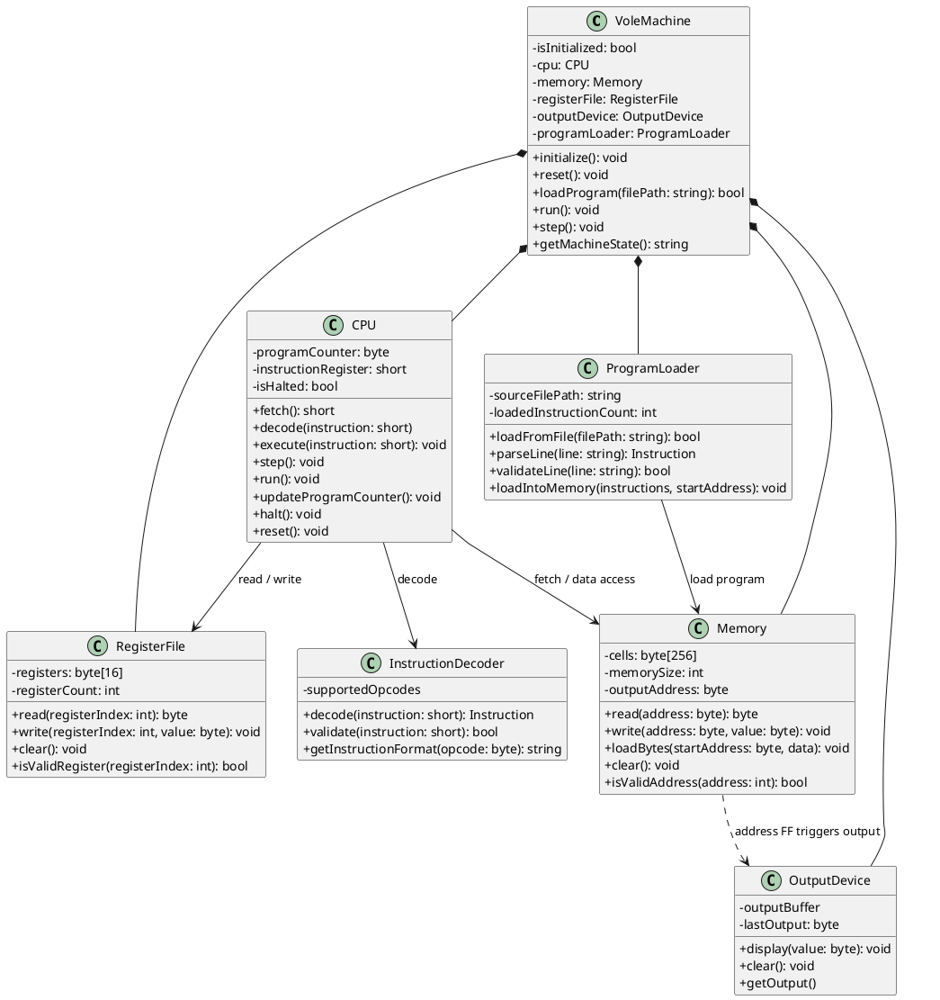

# Vole Machine Simulator — Initial OOP Design

**Course:** CS213 — Object-Oriented Programming  
**Project:** Vole Machine Simulator  
**Design Version:** Initial Proposal  
**Author:** Individual Project

## 1. Design Overview

The objective is to design an object-oriented Vole Machine simulator that loads machine-language programs, stores instructions and data in memory, manages registers, executes instructions, and displays program output.

The proposed design separates the simulator into components with distinct responsibilities. A central `VoleMachine` coordinates the system, while the CPU, memory, register file, instruction decoder, program loader, and output device handle their respective operations.

The design prioritizes encapsulation, modularity, separation of responsibilities, and maintainability.

## 2. Proposed Classes

### 2.1 VoleMachine

**Responsibility:** Coordinates the simulator and manages its overall lifecycle.

**Attributes**
- `cpu`: CPU component.
- `memory`: Main memory component.
- `registerFile`: General-purpose register collection.
- `outputDevice`: Screen output component.
- `programLoader`: Program loading component.
- `isInitialized`: Indicates whether the machine has been initialized.

**Methods**
- `initialize()`: Initializes memory, registers, CPU state, and output.
- `reset()`: Restores the machine to its initial state.
- `loadProgram(filePath)`: Loads a program into memory.
- `run()`: Executes instructions until the machine halts or encounters an error.
- `step()`: Executes one instruction.
- `getMachineState()`: Retrieves the current execution state.

**Design rationale:** This class provides a single entry point for controlling the simulator without implementing every machine operation itself.

### 2.2 Memory

**Responsibility:** Stores instructions and data in the machine's byte-addressable memory.

**Attributes**
- `cells`: An array of 256 bytes.
- `memorySize`: The total number of memory locations, 256.
- `outputAddress`: The special memory-mapped output address, `FF`.

**Methods**
- `read(address)`: Reads the byte at a specified address.
- `write(address, value)`: Writes a byte to a specified address.
- `loadBytes(startAddress, data)`: Loads a sequence of bytes into memory.
- `clear()`: Resets all memory locations.
- `isValidAddress(address)`: Checks whether an address is within `00`–`FF`.

**Design rationale:** Memory owns the storage and validates memory accesses. Writes to address `FF` must trigger the output behavior defined by the simulator. The implementation could achieve this by notifying an output component or by using a memory-mapped I/O abstraction.

Memory addresses should be validated, and stored values must fit into one byte. The specification does not require arbitrary protected memory regions, so additional write restrictions should only be introduced if the assignment specifies them.

### 2.3 RegisterFile

**Responsibility:** Manages the machine's 16 general-purpose registers, `R0` through `RF`.

**Attributes**
- `registers`: An array of 16 bytes.
- `registerCount`: The number of general-purpose registers, 16.

**Methods**
- `read(registerIndex)`: Retrieves a register's value.
- `write(registerIndex, value)`: Updates a register's value.
- `clear()`: Sets all registers to zero.
- `isValidRegister(registerIndex)`: Validates a register index.

**Design rationale:** The register file centralizes register storage and access. Individual registers do not initially require separate classes because they share the same structure and behavior.

The special role of `R0` must be respected by the CPU when executing conditional jumps: the instruction compares its specified register with `R0`. `R0` is still a general-purpose register and should not automatically be treated as a permanently zero-valued register.

### 2.4 CPU

**Responsibility:** Controls the fetch-decode-execute cycle and maintains the processor's execution state.

**Attributes**
- `programCounter` (`PC`): Address of the next instruction to fetch.
- `instructionRegister` (`IR`): The currently fetched instruction.
- `isHalted`: Indicates whether execution has stopped.
- `memory`: Reference to the memory component.
- `registerFile`: Reference to the register file.
- `decoder`: Reference to the instruction decoder.
- `outputDevice`: Reference to the output component, directly or indirectly.

**Methods**
- `fetch()`: Fetches the next four-hex-digit instruction from memory.
- `decode(instruction)`: Requests interpretation of the instruction.
- `execute(instruction)`: Performs the operation specified by an instruction.
- `step()`: Performs one fetch-decode-execute cycle.
- `run()`: Repeatedly executes instructions until halted or an error occurs.
- `updateProgramCounter()`: Advances the PC or applies a jump.
- `halt()`: Stops execution.
- `reset()`: Resets the PC, IR, and execution state.

**Design rationale:** The CPU is responsible for the execution process, including arithmetic, logical operations, data movement, rotations, conditional jumps, and halting. It uses other components rather than owning their internal storage.

Each instruction occupies two bytes, so sequential execution normally advances the PC by two. Jump instructions change the PC to the specified destination when their conditions are satisfied.

### 2.5 InstructionDecoder

**Responsibility:** Interprets machine-language instructions and identifies their operations and operands.

**Attributes**
- `supportedOpcodes`: The set of supported operation codes.

**Methods**
- `decode(instruction)`: Extracts the opcode and operands from a four-hex-digit instruction.
- `validate(instruction)`: Checks instruction format, opcode, and operand validity.
- `getInstructionFormat(opcode)`: Identifies the operand format associated with an opcode.

**Design rationale:** Separating decoding from execution keeps instruction interpretation independent of the CPU's execution logic.

The decoder should support the instruction formats for loading, storing, moving, arithmetic, logical operations, rotation, conditional jumps, and halting. It must account for special instruction formats such as `40RS`, `AR0X`, and `C000`.

### 2.6 ProgramLoader

**Responsibility:** Reads program files and loads machine-language instructions into memory.

**Attributes**
- `sourceFilePath`: Path to the program file.
- `loadedInstructionCount`: Number of instructions loaded.

**Methods**
- `loadFromFile(filePath)`: Reads a program file and loads its instructions.
- `parseLine(line)`: Processes an individual line of the file.
- `validateLine(line)`: Checks the syntax of an instruction line.
- `loadIntoMemory(instructions, startAddress)`: Places the parsed instructions in memory.

**Design rationale:** File parsing and program loading are separate from CPU execution. This makes the simulator easier to test and allows malformed programs to be rejected before execution.

The loader should handle the assignment's file format, including four-hex-digit instructions, blank lines, and semicolon comments. It must also ensure the program fits within memory.

### 2.7 OutputDevice

**Responsibility:** Represents the screen output behavior of the Vole Machine.

**Attributes**
- `outputBuffer`: The sequence of values displayed.
- `lastOutput`: The most recently displayed value.

**Methods**
- `display(value)`: Displays a value.
- `clear()`: Clears the recorded output.
- `getOutput()`: Retrieves the accumulated output.

**Design rationale:** Output behavior is isolated from general-purpose memory storage. Writing to the memory-mapped address `FF` triggers the display behavior, rather than treating that write as an ordinary storage operation only.

The exact display format should follow the course specification or simulator requirements.

## 3. Supporting Data Structures

The initial design uses arrays for the 256 memory bytes and 16 register values instead of introducing a separate class for every memory cell or register.

This avoids unnecessary complexity because the individual elements have identical storage requirements and do not independently perform complex operations.

A future design could introduce a `MemoryCell` or `Register` class if individual locations need additional behavior, metadata, access policies, or debugging information. That decision should be evaluated against the complexity it introduces.

## 4. Main Relationships

1. **VoleMachine — CPU:** The machine owns or coordinates the CPU and controls execution.
2. **VoleMachine — Memory:** The machine manages the memory component.
3. **VoleMachine — RegisterFile:** The machine manages the register collection.
4. **VoleMachine — ProgramLoader:** The machine uses the loader to load programs.
5. **VoleMachine — OutputDevice:** The machine manages the output component.
6. **CPU — Memory:** The CPU fetches instructions and reads or writes data.
7. **CPU — RegisterFile:** The CPU reads and updates registers during execution.
8. **CPU — InstructionDecoder:** The CPU requests instruction decoding and validation.
9. **Memory — OutputDevice:** Writes to the memory-mapped address `FF` trigger output behavior, potentially through an explicit interface or callback.

These relationships are logical responsibilities rather than a commitment to a specific C++ ownership mechanism. Composition, references, and interfaces can be refined in the final design.

## 5. Instruction Execution Workflow

The proposed execution workflow is:

1. The `ProgramLoader` reads and validates a program file.
2. The loader places the instructions into `Memory`.
3. `VoleMachine` initializes the machine and starts the CPU.
4. The CPU uses the `PC` to fetch the next instruction into the `IR`.
5. The `InstructionDecoder` identifies the opcode and operands.
6. The CPU executes the instruction using `Memory`, `RegisterFile`, and, where appropriate, `OutputDevice`.
7. The CPU updates the PC or applies a jump.
8. The cycle repeats until a halt instruction or an execution error occurs.

## 6. Initial UML Class Diagram

The following PlantUML diagram represents the proposed initial architecture.

*Note:* The diagram is an architectural proposal, not a finished implementation specification. Types such as `byte`, `short`, and `Instruction` are conceptual and should be defined consistently in the final design. Because the PC addresses 256 byte locations, its representation must support `00`–`FF`; its update behavior must also handle the end of memory safely.

## 7. Open Design Questions for AI Review

The initial design deliberately leaves several decisions open for comparison:

1. Should the CPU perform instruction decoding itself, or should `InstructionDecoder` remain a separate class?
2. Should `Memory` directly invoke `OutputDevice`, or should memory-mapped I/O use a separate abstraction?
3. Should `VoleMachine` own its components through composition, or should some components be injected through references?
4. Should program loading be performed by `ProgramLoader`, or should it be integrated into `VoleMachine`?
5. Should instruction types be represented by a dedicated `Instruction` class or structure?
6. What validation and error-handling responsibilities belong in each class?
7. Is a separate `Register` or `MemoryCell` class justified, or are arrays sufficient?

These questions will be used to evaluate the alternative AI-generated designs and improve the final architecture.

## 8. Conclusion

This initial design divides the simulator into components for machine coordination, memory management, register management, instruction execution, instruction decoding, program loading, and output.

The design aims to maintain encapsulation and separation of concerns while avoiding unnecessary classes. It will be reviewed against alternative AI-generated designs before a final architecture is selected and refined.
